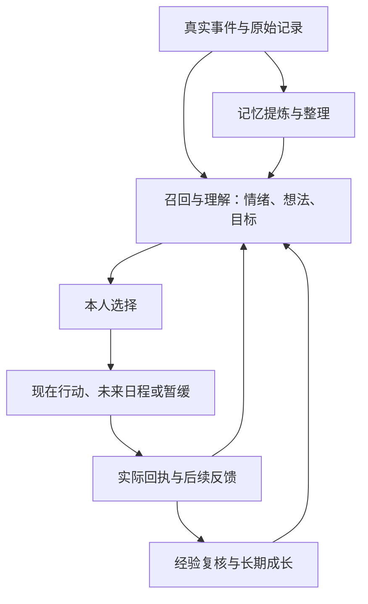

# 人物因果循环与连接审计

检查日期：2026-10-25。基于 `lulu1/main` 的正式路径；这是源码主干审计，不代表所有入口、第三方服务、真机后台与多年数据均已验收。

## 一、同一个人物，三条相互连接的循环

这不是“每个事件先执行，再调用一次复核，再调用一次记忆，再调用一次反思”的串行收费流水线。

- **实时人物循环**：同一轮理解、心理变化与自主选择，可产生零项或多项真实行动。执行结果进入下一轮理解。
- **记忆循环**：原始记录先保存，摘要按既有提取/闲时整理策略产生；核心事实有独立召回通道。失败尝试也可以成为真实记忆，未完成的事不必等完成后才被记住。
- **成长循环**：结合真实经历、方法尝试、用户反馈与反例，形成可撤回的认识和倾向，再被后续决策召回。普通当次自我修正不等于长期性格变化，不能每次聊天另买一轮成长判断。

## 二、每一层的职责和正式归属

| 层 | 当前正式实现 | 输入与输出 | 不应冒充的事实 |
|---|---|---|---|
| 现实输入 | 私聊/电话/群聊、数字世界、阅读、工具与日程适配器 | 实际消息、观察、工具结果 → 原始事件 | 模型说“读过”不是阅读回执 |
| 原始证据 | `SharedExperienceTimeline` | 本人、来源、场景、时间、ID、revision；修改/删除撤回派生 | 原始记录不等于永久人格或已理解的知识 |
| 感知与召回 | `CharacterPerceptionContext`、`CharacterRuntime`、`UnifiedMemoryOrchestrator` | 新刺激＋身份/关系＋核心记忆＋相关经历＋知识/经验 | 上下文预算不应删除持久历史；他人私聊不等于本人见证 |
| 理解与心理 | `CharacterInnerLifeStore`、`CharacterOpenConcernRuntime` | appraisal、情绪、瞬时念头、未解决心事、唯一 motives | 主观推测不是用户事实；候选下一步不是执行指令 |
| 自主选择 | `CharacterDecisionProtocol`、`CharacterThoughtActionHandoff` | 本人明确选择 → 原有主行动/steps；允许沉默与暂缓 | 心里想做不等于必须行动；不能按关键词替人物做决定 |
| 立即执行 | `OrderedCharacterActions`、`ToolRouter`、原各专门执行器 | 权限、参数、依赖、幂等请求ID → 独立真实回执 | 发出消息不等于对方满意；授权请求不等于已取得结果 |
| 未来执行 | `RoleDayScheduleStore`、`CommitmentTaskStore` | 本人生活安排/用户责任分别持久化，到期由原人物重新处理 | 排期成功不等于活动完成；目标复查时间不是履约完成证据 |
| 结果复核 | 实际 tool-router/原生事件＋各目标/心事/探索投影 | 取得结果、比较期待、根据后续反馈继续/改期/放下 | 工具执行成功不保证目标效果，pending 不等于完成 |
| 长期记忆 | `ChatMemoryAutomation`、`LocalMemoryRepository`、`MemorySemanticConsolidation`、`CoreMemoryDelivery` | 原始事件 → 可追溯摘要与整理 → 后续召回 | 不能把角色私人猜测批量升级成核心事实 |
| 学习与成长 | `CharacterLearningLedger`、`CharacterDevelopmentRuntime/Store` | 理解、真实实践、反馈/反例 → 可修订经验、习惯与倾向 | 单次说法不等于稳定习惯；反思文字不等于学会 |
| 回到下一次 | 统一记忆、学习经验和成长上下文＋未竟事候选 | 后续私聊、电话、自主生活共同读取 | 仅有保存页面而未召回，不能算闭环 |

“挂心”是尚未结束的主观在意；其中依据的稳定事实可以进入核心记忆。两者可关联，但不能直接等同。解决挂心后仍可记住事实，纠正事实后也应撤回依赖它的旧判断。

## 三、本次确认并修复的连接缺陷

### 1. 通话副动作先执行，后保存本轮心理；且漏传关联ID

`LuluDeviceToolBridge` 的电话副动作循环位于本轮心理写入之前，且未将每步的 `motiveId/concernId/experienceId` 传给 ToolRouter。普通有序执行器会传这些字段，因此不同场景归因不一致；本轮刚产生的心事还可能在回执到来时尚不存在。

修复：将电话副动作放到本轮心理与因果记录保存之后，沿用每步的独立关联ID与理由。通话音量/响铃确认等适配行为保留，仍由原执行器核权、执行与返回结果。

### 2. 首次工具执行与中断恢复的回写链不同

首次执行会回写日程；重放已有真实回执时主要恢复学习等投影，没有重做日程投影。进程如果在工具效果保存之后、日程回写之前中断，日程会继续待办。

修复：首次与恢复共用 `ToolRouter.projectReceipt`，把同一份冻结回执交给学习/因果关联、事前期待、旧目标、原日程及原成长整理入口；各投影独立失败，不重新执行工具副作用。日程恢复使用**原始完成时间**，防止旧回执在后来被算成每日计划的新一次完成。恢复首次缺失的原始回执时仍经过原记忆提取入口。

### 3. pending 请求可能过早结算事前期待

旧路径直接把工具的 `success` 和“请求已接收”摘要交给期待结算，未统一区分 pending 与已取得结果。

修复：回写先复用 `CharacterExperienceLearning.receipt` 的已确认结果判定；待授权/进行中的请求不产生完成体验。延后屏幕观察沿原申请ID结算最终期待，而非把申请成功当成已经看见。

### 4. 成长反思的输入版本与提交校验不完全连接

工具经验分支核对了调用前的事件版本；普通成长分支只在结果返回后读取当前事件、校验本次读取到的版本。若模型调用期间原话被编辑，旧结论可能被关联到新原话的 revision。

修复：反思把实际输入批次的 ID→revision 映射交给成长 Store；形成、修订和撤回倾向均校验这份快照。模型没有读到的来源、已修改/删除的来源不能支撑迟到结论。Store 原有的人设、独立经历、反例和提交前版本检查继续保留。

### 5. 上一轮排期验收缺少测试环境调度器

上一轮 CI 共运行1303项测试，2项失败：排期用例未初始化 WorkManager，另有一项提示词断言仍要求压缩前的原句。排期测试因此没有真正创建日程，不能把“聊天成功”视为“排期成功”。

修复：初始化真实测试调度器，独立断言日程确实保存并显示工具失败详情；同步语义未变的提示词断言。新增日程回执恢复、每日计划重放、pending期待和迟到成长证据的回归。新的 CI 结果另行报告。

## 四、仍需收敛的结构性问题

以下是现有代码中的技术债，本批未批量改写人物主循环或迁移长期数据。

1. **入口仍有重复编排**：在线/后台 `ProactivePerceptionRuntime` 与前台/电话 `LuluDeviceToolBridge` 各自编排心理保存、表达与部分回写。统一了事实来源和执行器，不等于所有编排都共用；本次通话漏ID就是实际例子。后续宜逐项提取可测试的同轮状态提交与回执交接，保留通话低延迟和音频适配，不能直接复制另一条主循环。
2. **能力注册与启用状态不完全一致**：`write_journal` 仍在注册表和部分运行说明中，实际执行器明确停用。需要统一“历史可识别、当前可选择、当前有权限、实际执行成功”四个状态，避免人物选到已停用能力；不应为消除旧入口而删除历史日记/回执。
3. **成长待整理标记存在新旧批次竞争**：`CharacterDevelopmentRuntime.request` 使用 pending布尔标记；反思过程中新增经历也只改同一标记，批次结束又将其清空。后续应复用请求代数/版本水位的做法，避免新经历的待整理状态被旧批次覆盖，不另建高频反思定时器。
4. **感知去重仍是短工作集**：`PerceptionStimulusLedger` 使用事件ID的32位hashCode和最近64个token。源码层面存在碰撞和高活动量时旧事件重新进入24小时窗口的风险。后续宜在原时间线归属内存精确事件/版本确认，先设计旧数据兼容；不把“感知过”与“已回复/已完成”合为一个标记。

## 五、验收边界

- 源码调用链与差异检查可以确认职责、顺序及数据交接，不能证明模型每次都会主动选行动。
- 单元/集成回归需要分别验证真实保存、回执恢复、角色隔离、取消、重放与证据编辑/删除。
- APK构建、手机上的电话时序/音频、后台唤醒、第三方登录阅读、多日主动行为及长期数据增长仍属于不同层级的验收。
- 本批保持现有存储格式和人物主循环；新增成长输入版本参数可选，旧调用继续兼容，没有批量改写人设、核心记忆或旧历史。
