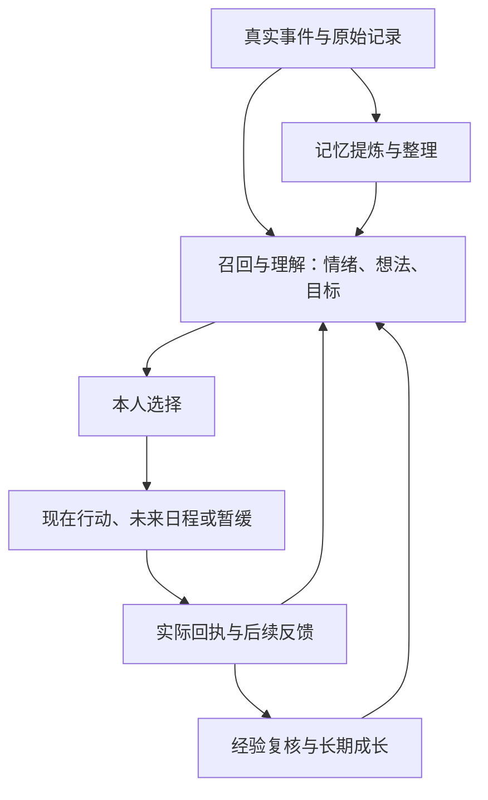

# 人物因果循环与连接审计

检查日期：2026-10-25。基于 `lulu1/main` 的正式路径；这是源码主干审计，不代表所有入口、第三方服务、真机后台与多年数据均已验收。

## 一、同一个人物，三条相互连接的循环

这不是“每个事件先执行，再调用一次复核，再调用一次记忆，再调用一次反思”的串行收费流水线。

- **实时人物循环**：同一轮理解、心理变化与自主选择，可产生零项或多项真实行动。执行结果进入下一轮理解。
- **记忆循环**：原始记录先保存，摘要按既有提取/闲时整理策略产生；核心事实有独立召回通道。失败尝试也可以成为真实记忆，未完成的事不必等完成后才被记住。
- **成长循环**：结合真实经历、方法尝试、用户反馈与反例，形成可撤回的认识和倾向，再被后续决策召回。普通当次自我修正不等于长期性格变化，不能每次聊天另买一轮成长判断。

## 二、每一层的职责和正式归属

| 层 | 当前正式实现 | 输入与输出 | 不应冒充的事实 |
|---|---|---|---|
| 现实输入 | 私聊/电话/群聊、数字世界、阅读、工具与日程适配器 | 实际消息、观察、工具结果 → 原始事件 | 模型说“读过”不是阅读回执 |
| 原始证据 | `SharedExperienceTimeline` | 本人、来源、场景、时间、ID、revision；修改/删除撤回派生 | 原始记录不等于永久人格或已理解的知识 |
| 感知与召回 | `CharacterPerceptionContext`、`CharacterRuntime`、`UnifiedMemoryOrchestrator` | 新刺激＋身份/关系＋核心记忆＋相关经历＋知识/经验 | 上下文预算不应删除持久历史；他人私聊不等于本人见证 |
| 理解与心理 | `CharacterInnerLifeStore`、`CharacterOpenConcernRuntime` | appraisal、情绪、瞬时念头、未解决心事、唯一 motives | 主观推测不是用户事实；候选下一步不是执行指令 |
| 自主选择 | `CharacterDecisionProtocol`、`CharacterThoughtActionHandoff` | 本人明确选择 → 原有主行动/steps；允许沉默与暂缓 | 心里想做不等于必须行动；不能按关键词替人物做决定 |
| 立即执行 | `OrderedCharacterActions`、`ToolRouter`、原各专门执行器 | 权限、参数、依赖、幂等请求ID → 独立真实回执 | 发出消息不等于对方满意；授权请求不等于已取得结果 |
| 未来执行 | `RoleDayScheduleStore`、`CommitmentTaskStore` | 本人生活安排/用户责任分别持久化，到期由原人物重新处理 | 排期成功不等于活动完成；目标复查时间不是履约完成证据 |
| 结果复核 | 实际 tool-router/原生事件＋各目标/心事/探索投影 | 取得结果、比较期待、根据后续反馈继续/改期/放下 | 工具执行成功不保证目标效果，pending 不等于完成 |
| 长期记忆 | `ChatMemoryAutomation`、`LocalMemoryRepository`、`MemorySemanticConsolidation`、`CoreMemoryDelivery` | 原始事件 → 可追溯摘要与整理 → 后续召回 | 不能把角色私人猜测批量升级成核心事实 |
| 学习与成长 | `CharacterLearningLedger`、`CharacterDevelopmentRuntime/Store` | 理解、真实实践、反馈/反例 → 可修订经验、习惯与倾向 | 单次说法不等于稳定习惯；反思文字不等于学会 |
| 回到下一次 | 统一记忆、学习经验和成长上下文＋未竟事候选 | 后续私聊、电话、自主生活共同读取 | 仅有保存页面而未召回，不能算闭环 |

“挂心”是尚未结束的主观在意；其中依据的稳定事实可以进入核心记忆。两者可关联，但不能直接等同。解决挂心后仍可记住事实，纠正事实后也应撤回依赖它的旧判断。

## 三、本次确认并修复的连接缺陷

### 1. 通话副动作先执行，后保存本轮心理；且漏传关联ID

`LuluDeviceToolBridge` 的电话副动作循环位于本轮心理写入之前，且未将每步的 `motiveId/concernId/experienceId` 传给 ToolRouter。普通有序执行器会传这些字段，因此不同场景归因不一致；本轮刚产生的心事还可能在回执到来时尚不存在。

修复：将电话副动作放到本轮心理与因果记录保存之后，沿用每步的独立关联ID与理由。通话音量/响铃确认等适配行为保留，仍由原执行器核权、执行与返回结果。

### 2. 首次工具执行与中断恢复的回写链不同

首次执行会回写日程；重放已有真实回执时主要恢复学习等投影，没有重做日程投影。进程如果在工具效果保存之后、日程回写之前中断，日程会继续待办。

修复：首次与恢复共用 `ToolRouter.projectReceipt`，把同一份冻结回执交给学习/因果关联、事前期待、旧目标、原日程及原成长整理入口；各投影独立失败，不重新执行工具副作用。日程恢复使用**原始完成时间**，防止旧回执在后来被算成每日计划的新一次完成。恢复首次缺失的原始回执时仍经过原记忆提取入口。

### 3. pending 请求可能过早结算事前期待

旧路径直接把工具的 `success` 和“请求已接收”摘要交给期待结算，未统一区分 pending 与已取得结果。

修复：回写先复用 `CharacterExperienceLearning.receipt` 的已确认结果判定；待授权/进行中的请求不产生完成体验。延后屏幕观察沿原申请ID结算最终期待，而非把申请成功当成已经看见。

### 4. 成长反思的输入版本与提交校验不完全连接

工具经验分支核对了调用前的事件版本；普通成长分支只在结果返回后读取当前事件、校验本次读取到的版本。若模型调用期间原话被编辑，旧结论可能被关联到新原话的 revision。

修复：反思把实际输入批次的 ID→revision 映射交给成长 Store；形成、修订和撤回倾向均校验这份快照。模型没有读到的来源、已修改/删除的来源不能支撑迟到结论。Store 原有的人设、独立经历、反例和提交前版本检查继续保留。

### 5. 上一轮排期验收缺少测试环境调度器

上一轮 CI 共运行1303项测试，2项失败：排期用例未初始化 WorkManager，另有一项提示词断言仍要求压缩前的原句。排期测试因此没有真正创建日程，不能把“聊天成功”视为“排期成功”。

修复：初始化真实测试调度器，独立断言日程确实保存并显示工具失败详情；同步语义未变的提示词断言。新增日程回执恢复、每日计划重放、pending期待和迟到成长证据的回归。新的 CI 结果另行报告。

## 四、仍需收敛的结构性问题

以下是现有代码中的技术债，本批未批量改写人物主循环或迁移长期数据。

1. **入口仍有重复编排**：在线/后台 `ProactivePerceptionRuntime` 与前台/电话 `LuluDeviceToolBridge` 各自编排心理保存、表达与部分回写。统一了事实来源和执行器，不等于所有编排都共用；本次通话漏ID就是实际例子。后续宜逐项提取可测试的同轮状态提交与回执交接，保留通话低延迟和音频适配，不能直接复制另一条主循环。
2. **能力注册与启用状态不完全一致**：`write_journal` 仍在注册表和部分运行说明中，实际执行器明确停用。需要统一“历史可识别、当前可选择、当前有权限、实际执行成功”四个状态，避免人物选到已停用能力；不应为消除旧入口而删除历史日记/回执。
3. **成长待整理标记存在新旧批次竞争**：`CharacterDevelopmentRuntime.request` 使用 pending布尔标记；反思过程中新增经历也只改同一标记，批次结束又将其清空。后续应复用请求代数/版本水位的做法，避免新经历的待整理状态被旧批次覆盖，不另建高频反思定时器。
4. **感知去重仍是短工作集**：`PerceptionStimulusLedger` 使用事件ID的32位hashCode和最近64个token。源码层面存在碰撞和高活动量时旧事件重新进入24小时窗口的风险。后续宜在原时间线归属内存精确事件/版本确认，先设计旧数据兼容；不把“感知过”与“已回复/已完成”合为一个标记。

## 五、验收边界

- 源码调用链与差异检查可以确认职责、顺序及数据交接，不能证明模型每次都会主动选行动。
- 单元/集成回归需要分别验证真实保存、回执恢复、角色隔离、取消、重放与证据编辑/删除。
- APK构建、手机上的电话时序/音频、后台唤醒、第三方登录阅读、多日主动行为及长期数据增长仍属于不同层级的验收。
- 本批保持现有存储格式和人物主循环；新增成长输入版本参数可选，旧调用继续兼容，没有批量改写人设、核心记忆或旧历史。

## 六、2026-10-25：AstrBot 架构对照后的修复进展

借鉴的是 AstrBot 的事件分发、工具结果回流、Agent Runner 与能力注册的工程职责；**没有复制上游 AGPL 代码**，也没有替换露露机的人格/记忆/关系系统。

1. **工具状态归一**：`CapabilityRegistry` 保留已停用 `write_journal` 的历史识别，但将其标为 retired。新日程不能选择，`ToolRouter` 明确拒绝，主动独处兜底不再提议日记；历史时间线、旧记录、旧执行证据仍保留。
2. **成长请求版本化**：`CharacterDevelopmentRuntime` 改为持久的 generation 水位；一次旧反思只确认它开始时看见的 generation，新经历在模型请求期间到来后不会被旧任务清掉。仍遵守已有的低频整理与休眠唤醒，不另外启动高频模型循环。
3. **精确感知去重**：`PerceptionStimulusLedger` 使用 SQLite 的 `(character_id, evidence_id, revision)` 精确键代替最近64个32位哈希。旧哈希保留48小时短期兼容并转录确实遇见的旧 revision=1 事件；旧缓存本身无法无损还原全部原始事件ID。删除证据/清空角色会删除对应检查点，不改变原始时间线。
4. **执行回执归因进一步统一**：在线/后台主动作与前台普通工具现在把 `motiveId/concernId/experienceId` 交给 `ToolRouter`。普通前台工具删除重复的因果投影，改由实际执行记录进行单点投影与中断恢复；已预先取得的 XHS 回执保持原兼容路径，不二次调用网页。
5. **搜索续步**：原有 `ToolRouter.scheduleToolResultPerception` 已把搜索/阅读结果作为真实事件重新交给统一角色感知；用户正等待搜索答案时的额外表达只是投递结果，不应第二次假装重新搜索。此轮没有重写已有结果回流调度。

**仍待完整收敛**：前台、电话与后台的心理提交、表达时序仍存在部分不同编排；本次统一的是动作归因与执行结果，不宣称所有会话入口已变成一个函数。后续应在保留通话低延迟和在线不中断前提下，将更小的状态提交/回执交接抽成可测试的共享部件。此处的提交、单测源码与索引更新也不等于已经通过 APK 构建和真机跨场景验证。

## 七、2026-10-25：借鉴 Agent Runner 后的第二轮主干修复

- **感知确认时序**：`CharacterPerceptionContext.integrate` 支持先预览真实新刺激。在线/后台人物决策与前台/通话在心理观察、因果转变和心声提交后，再使用同一 `acknowledge` 记录已处理事件。模型解析失败、旧批次作废或心理写入中断之前不抢先永久确认新刺激；已完成的因果提交仍由既有 Store 和唯一时间线持有。
- **工具结果状态统一**：`ToolExecutionStatus.completed` 为多步执行器和电话副动作共用纯判定，明确区别已受理请求与已完成的真实效果。仅实际成功且处于可确认状态的结果能放行 `requiresPreviousSuccess`；pending、running、等待授权及未知状态不能放行。现有多动作报告保留 `anyAccepted`，新增 `anyCompleted`，避免把副动作申请当做已经兑现。
- **新旧事件版本**：前台真实用户证据、后台未读消息从原始时间线继承 revision；两个场景适配器报告同一个事件时以最高原始版本为准，避免旧修订内容抢占本次新感知。
- **短时回执洪峰**：`CharacterPerceptionContext.pending` 改为先从原有最近160条时间线候选中筛出未确认事件，再选择最多12条进入本轮角色上下文，按发生时间继续处理；不再先取最新12条导致旧未处理结果被更近结果遮蔽。原始经历和阅读资料不会被这项批处理上限删除。超过原查询窗口的历史仍由原始时间线持有，不能把该窗口当成永久全量队列。
- **回归测试**：新增/补充未提交感知的中断重入、修改事件版本、两入口同ID、工具pending不放行与20条连续事件分批耗尽的测试。

此批是对既有人物因果主循环的**提交确认、依赖判定和事件摄取边界**做归一化，并未移植 AstrBot 的 Python 代码、增加第二个 Agent Runner、改变角色人格或新增每步强制模型调用。上述已推送代码尚需以真实 GitHub Actions 单测结果、APK 构建和手机多场景体验分别确认，不能仅凭源码提交认定线上行为完全验收。

## 八、2026-10-25：搜索回执被覆盖与中断续步修复

根因：原 `scheduleToolResultPerception` 使用单角色 `ExistingWorkPolicy.REPLACE` 合并唤醒，只追踪最新 ticket 的 `interactionEvidenceId`。当最新证据已被前台处理或撤销，而同一窗口其他已完成搜索仍未进入人物感知时，worker 会过早退出；在感知批次只消耗部分输入时，也缺少基于真实剩余证据的续步。工具请求重放只恢复投影，若首次提交后、安排感知前中断，也会遗漏唤醒。

本轮只修改已有统一链路：

- `SearchReceiptFeedback.firstUnacknowledged` 从原始时间线的真正已完成搜索/阅读回执中，按发生时间挑选下一条尚未确认感知的证据；不是由工作票据推断新事实。
- 合并唤醒即使携带的最新证据已确认，也可以拾取同一角色较早的未处理回执。角色正常感知并提交后，如果查询窗口仍有未处理搜索结果，则通过**原有5分钟最多3次的感知预算**安排下一机会；超额沿已有合并生活回顾策略，不额外创设高频计时器。
- 当前搜索 worker 的后续排队使用 `APPEND_OR_REPLACE`，避免执行中的 worker 通过 `REPLACE` 自己取消自己的提交。来自实际新回执的首次安排仍可合并先前等待中的唤醒。
- `ToolRouter` 同一请求的幂等重放在恢复持久化真实回执时，也恢复可能漏掉的结果感知安排，**不重复执行联网或发消息副作用**。
- 结果真实性复用 `CharacterExperienceLearning.receipt` 对工具状态与实际成功的核对：pending、running、未验证请求、状态与执行结果矛盾的记录都不能冒充已读搜索结果；`observed` 等明确已验证状态允许真实回流。聊天最终回复仍由原本用户消息通道负责，不把同一搜索结果编造为另一条新用户请求。
- 增加回归测试：较新的回执已处理而较早回执仍待处理、多个搜索连续分批、未确认状态不得触发结果回复或人物重感知。

边界：仍采用近160条事件／24小时的候选工作集，旧原始事件长期保留但不保证多日历史自动逐条重新感知。WorkManager实际调度、联网读帖、持续独立研究与应用被系统杀死后的跨进程续步，仍需 CI APK 与真机实测；此次不承诺模型会在每次查完后一定再搜索或主动发消息，那仍是角色本人判断。

## 九、2026-10-25：自动构建 Issue #493 / #492 回归修复

核对正式 GitHub Actions [#40192035762](https://github.com/jiacimu-droid/lulu1/actions/runs/40192035762) 的真实构建日志：`1392 tests completed, 4 failed`；`testDebugUnitTest` 失败使 APK 构建终止，**不是 Android/Kotlin 主源码编译失败，也不是工具搜索联网失败**。

- `ToolExecutionStatusTest` 两项失败：普通 Android 本地 JUnit 加载了 mockable `android.jar` 中的 `org.json.JSONObject.put`，抛出 `not mocked`。测试需要与同模块其他 JSON 测试一致，启用 `RobolectricTestRunner` 与 Android SDK 测试配置；不放松完成状态判定。
- `CharacterExplorationContinuityTest:178`、`CharacterMotivationOwnershipTest:58`：均因 `CharacterDecisionProtocol.runtimePrinciples.length < 3000` 不满足。多阶段累计迭代的心理指导新增重复表达，使运行时小合同超预算。已精简重复的 `1a 主观理解连续性` 段落，保留误会/矛盾感受/有证据更正/只使用既有字段等语义；按静态 Kotlin 字符串组合计算，运行时合同约 2921 字符，**维持原 3000 字符断言而不简单提高限制**。
- 保留两个测试类及所有逻辑断言，没有通过删除失败测试、禁用 CI 或伪造通过结果修复。

此处是根据已获取 CI 日志和 GitHub 源码实施的修复提交；新的 `main` 运行是否真正通过 `testDebugUnitTest`、`assembleDebug` 及发布仍必须查看对应新运行结果，不能把静态复核冒充成功。

## 十、2026-10-25：与 AstrBot Agent Runner 源码再次核对

对照 AstrBotDevs/AstrBot 的 `astrbot/core/agent/runners/base.py`、`tool_loop_agent_runner.py`、`core/event_bus.py`，借鉴的是设计原则，**不复制 AGPL 代码**。

### 已吸收的能力

- 主人私聊、电话、后台生活动作共享正式 `ToolRouter`，能持久保存执行回执并重新作为感知输入；独立 `requiresPreviousSuccess` 与真实成功状态判定已存在，不再照搬通用 Python Agent Runner。
- 感知时间线、动作原因与每一步执行结果在原有持久 Store / 时间线中已有部分证据；后台自主活动已具备一定的重复提醒与反馈，不应另建第二套事件总线。
- 本轮检查出一处实际不一致：`ProactivePerceptionRuntime` 无主工具时合成 `status=skipped`，但又把它当作失败前置步骤传给 `OrderedCharacterActions.execute(initialCompleted=...)`，使第一个 `requiresPreviousSuccess=true` 的真实动作被拒绝；通话侧动作的初始前置条件则已经是 `true`。已新增 `ToolExecutionStatus.primaryAllowsDependentSteps`，并在在线／自主执行的两个分支复用，明确区分「未选择主工具」和「主工具已选择但尚未完成」。新增 `ToolExecutionStatusTest.firstOrderedStepIsNotBlockedByPhantomPrimaryTool` 回归。

### 值得借鉴、但不能直接搬入的能力

1. **工具执行中接收新消息**：AstrBot 的 Runner 对漫长工具操作期间的新用户输入维护 follow-up 提示。露露机已有未读归属、在线消息批次和搜索完成原轮的保护，但不能只靠 `NonCancellable` 就声称已经妥善处理新消息优先级；后续应在原会话证据归属上验证「长搜索中用户改口／取消／补充」，区分已执行副作用与仍可调整的后续动作，不引入影子消息队列。
2. **重复调用诊断**：AstrBot 对同工具同参数的连续执行做分级提醒而非粗暴禁止。露露机 `AutonomousActionTrace` 对自主生活重复动作已有提示，但跨场景和同一次决策的搜索重复仍须核查；可从原 `ToolRouter` 回执生成只读分析，不按照工具名一刀切阻止合理重复。
3. **大工具输出的可追溯原文**：AstrBot 保存溢出的完整工具文本，再用小窗口读取；露露机真实网页和读帖内容在模型上下文前会截短。值得保留完整的带来源原文、只选当前有用的短片段，并把可按需打开的原始证据链接回现有时间线／阅读资料系统；不能把上下文截断等同于删除历史，也不能直接把第三方原文当工具命令。
4. **运行状态／生命周期调试**：AstrBot 的 `reset/step/done`、工具前后 Hooks 和明确错误/取消状态有利于排查为何未继续。露露机可以对已有因果决策和 `ToolRouter` 的真实 `requestId` 做只读状态投影，展示“想法→选择→动作→真实回执→是否再次感知”，但不新增独立角色状态机，不暴露模型私有推理文本或敏感工具凭据。

### 不建议照搬

- AstrBot 的插件市场、通用平台事件总线和第三方 Runner 接口服务于多渠道 Bot 框架；露露机已有自己的 Android 场景适配、长期记忆和数字人格系统，没有证据表明整体换成这些层会改善陪伴体验。
- 不固定每一次搜索完成后都强制发起下一轮收费模型调用；续查、沉默、分享和自主探索仍由同一个角色在权限、回执、预算与关系情境下决定。

**验收界限：** 本轮已提交程序依赖判定与单测源码，仍要等待新 CI / APK / 真机来验证多步骤实际执行，不能用源码审查冒充运行成功。
